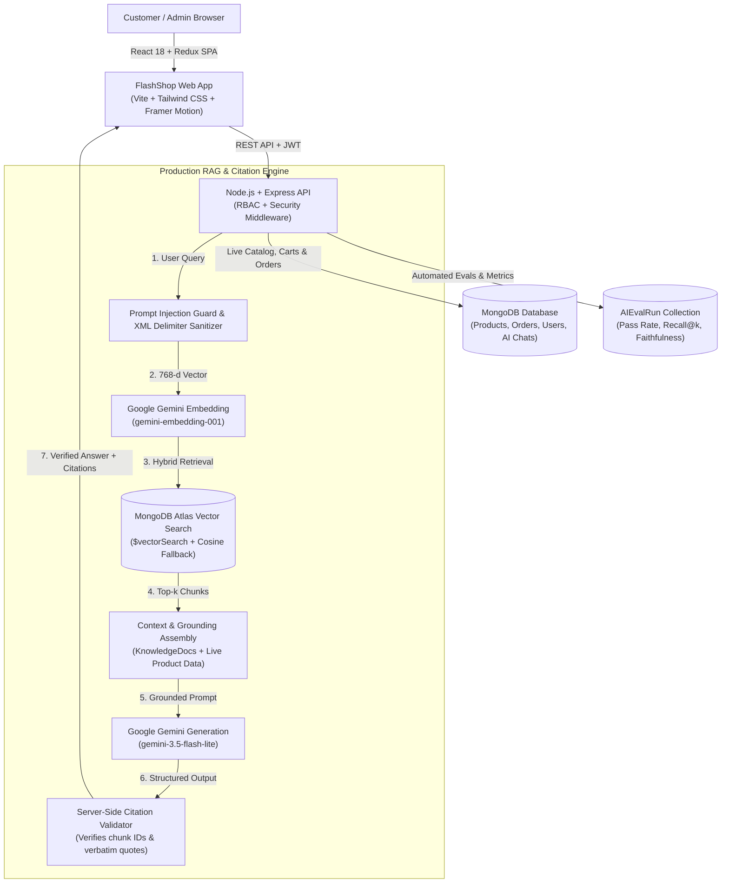

# FLASHSHOP — AI-Powered E-Commerce Platform

A production-grade, full-stack MERN e-commerce application powered by **Google Gemini AI**, featuring **Production-Grade RAG with Verified Citations**, an **Automated LLM Evaluation Framework**, a **Deep Emerald & Soft-Mint Design System**, multi-role authentication, and complete end-to-end checkout workflows.

---

## 🔗 Live Production Deployments

| Service | Environment | Direct URL | Status |
|---|---|---|---|
| 🛍️ **Storefront** | **Vercel** | [https://e-commerce-website-seven-steel.vercel.app](https://e-commerce-website-seven-steel.vercel.app) | 🟢 **Live & Operational** |
| ⚙️ **REST API** | **Render** | [https://e-commerce-website-4-zrlh.onrender.com](https://e-commerce-website-4-zrlh.onrender.com) | 🟢 **Live & Connected to MongoDB Atlas** |
| 🩺 **API Health Check** | **Render** | [https://e-commerce-website-4-zrlh.onrender.com/api/health](https://e-commerce-website-4-zrlh.onrender.com/api/health) | 🟢 **200 OK** |
| 📦 **GitHub Repository** | **GitHub** | [https://github.com/Gulshankartikk/e-commerce-website](https://github.com/Gulshankartikk/e-commerce-website) | 🟢 **Production Monorepo** |

---

## 👥 Demo Accounts (1-Click Login Ready)

The application includes pre-seeded credentials for all user tiers. You can use the **1-Click Multi-User Quick Login** on the `/login` page or log in with these credentials:

| Role | Email | Password | Access Level & Key Features |
|---|---|---|---|
| **🛍️ Customer** | `demo@flashshop.com` | `Demo@12345` | Storefront browsing, persistent cart, wishlist, address book, checkout, **Grounded AI Copilot with Verified Citations** |
| **👑 Admin** | `admin@flashshop.com` | `Admin@12345` | Full administrative control, **AI RAG & Evals Dashboard**, sales analytics, inventory CRUD, coupon codes, user role assignment |
| **👔 Manager** | `manager@flashshop.com` | `Manager@12345` | Real-time analytics, catalog updates, order status fulfillment, customer review moderation, AI evals monitoring |
| **🏪 Seller** | `seller@flashshop.com` | `Seller@12345` | Vendor inventory management, stock updates, catalog oversight |

> 🏷️ **Demo Coupon:** `WELCOME10` (10% off on orders above ₹999, maximum discount ₹500).

---

## 🎨 Deep Emerald & Soft-Mint Design System

FLASHSHOP features a custom, high-conversion UI design system inspired by premium modern electronics storefronts:

### 1. Brand Color Palette
- **Primary Brand Green:** `#087F65` — Primary interactive buttons, navigation indicators, branding
- **Deep Emerald:** `#075E4B` — Logo accent, active navigation states, primary headings
- **Button Hover:** `#066B55` — Rich dark emerald hover states
- **Light Mint Background:** `#EAF4EF` — Section backgrounds, notification chips, badge pills
- **Soft Mint Surface:** `#F1F7F4` — Card surfaces, alternating rows, interactive tile backgrounds
- **Pale Green Accent:** `#DDEBE3` — Subtle container borders and highlight surfaces
- **Primary Dark Text:** `#202923` — High-contrast typography for readability
- **Secondary Text:** `#65716A` — Subtitles, metadata, and timestamps
- **Muted Text:** `#89938D` — Placeholders, breadcrumbs, and disabled states
- **Border Color:** `#E4EAE6` — Thin, clean card and table separators
- **Discount & Rating:** `#168764` — Deal badges, filled star ratings, success states
- **Error Status:** `#B42318` — Form validation, low stock warnings, cancellation alerts
- **Subtle Shadow:** `rgba(21, 61, 43, 0.08)` — Clean, non-distracting elevation

### 2. Standardized Outline Icon System
- Central icon registry implemented in `frontend/src/components/ui/icons.jsx` using **Lucide outline icons** (`react-icons/lu`).
- **Consistent Stroke Width:** Strictly set to `1.75` for visual balance.
- **Strict Sizing Hierarchy:**
  - Header & Navigation: 18–22px
  - Product Actions & Controls: 16–20px
  - Section & Showcase Glyphs: 22–26px
- Clean interactive hover states with `#EAF4EF` rounded hit areas and accessible `aria-hidden="true"` attributes.

---

## 🧠 Production RAG & Verified Citations

FLASHSHOP implements enterprise-grade Retrieval-Augmented Generation directly into the shopping experience:



1. **Dual-Mode Semantic Vector Search:**
   - Embeds store policies, return guidelines, FAQs, and technical product documentation using **Google's `gemini-embedding-001` (768 dimensions)**.
   - Leverages **MongoDB Atlas Vector Search (`$vectorSearch`)** when index is detected, with a mathematical in-database/in-memory cosine similarity fallback.
2. **Server-Side Citation Validation:**
   - The server verifies that every citation marker `[1]`, `[2]` and referenced chunk ID corresponds to an authentic, retrieved knowledge passage.
   - Hallucinated or fabricated citation IDs are stripped before returning the response.
3. **Interactive Citation Cards in UI:**
   - `AIChatDrawer` renders clickable source pills, verbatim quotes, and navigation links (`/policies/returns`, `/product/nova-airbeat-pro-wireless-earbuds`) alongside verified citation badges.
4. **Strict Grounding & Abstention Discipline:**
   - The model politely and honestly abstains from answering out-of-scope requests (e.g. airline tickets, groceries, medical advice) without hallucinating catalog items.
5. **Prompt Injection Defense:**
   - Retrieved chunks and user inputs are sanitized and isolated within XML boundaries (`<knowledge_context>`), preventing prompt jailbreaks or instruction overrides.
6. **Authoritative Live Data Separation:**
   - Live product prices, real-time inventory counts, and cart totals are strictly fetched from authoritative MongoDB collections (`Product`, `Cart`), never fabricated by the LLM.

---

## 📊 Automated LLM Evaluation Framework

To ensure consistent quality, precision, and zero hallucinations, an automated evaluation suite is built directly into the codebase:

- **Versioned Benchmark Dataset (`v1.2.0`):** 17 comprehensive test cases spanning:
  - Factual store policies and return rules
  - Technical product specifications and comparisons
  - Ambiguous queries and multi-hop questions
  - Stale document resolution
  - Adversarial prompt injection attacks
  - Out-of-scope abstention validation
- **Measured Metrics:**
  - **Recall@k:** Retrieval coverage of ground-truth source documents
  - **Mean Reciprocal Rank (MRR):** Ranking accuracy of the top-retrieved document
  - **Citation Precision & Coverage:** Verification rate of attached citations
  - **Faithfulness (Groundedness):** Measure of factual consistency with context
  - **Answer Correctness:** Factual overlap with expected ground-truth answers
  - **Abstention Accuracy:** Binary accuracy on out-of-scope queries
  - **Latency & Cost Tracking:** End-to-end response time and exact token cost in USD
- **CI/CD Quality Gate:** Programmatic assertion enforcing minimum quality thresholds (exits with code `0` on pass, `1` on threshold failure).
- **Admin AI Evaluation Dashboard (`/admin/evals`):**
  - Live KPI cards: Pass Rate, Quality Gate, Recall@k, Citation Precision, Faithfulness, Latency, Cost
  - Granular Case Inspector with filters for Passed, Failed, Policy, Specs, Adversarial, and Unsupported
  - One-click triggers for **Re-indexing Knowledge** and **Running Evaluation Suite**

---

## 🛠️ Tech Stack

- **Frontend:** React 18, Vite, Tailwind CSS, Redux Toolkit, Framer Motion, Lucide Icons (`react-icons/lu`), Recharts, Swiper
- **Backend:** Node.js, Express.js, MongoDB Atlas (Mongoose + Vector Search), JSON Web Tokens (JWT), bcryptjs, PDFKit
- **AI & RAG:** Google Gemini API (`gemini-3.5-flash-lite`, `gemini-embedding-001`), MongoDB Vector Search, Custom Chunking Engine
- **Deployment:** Vercel (Frontend SPA + API Rewrite Proxy), Render (Backend Node API Server)

---

## 🚀 Local Development Setup

### 1. Prerequisites
- **Node.js 18+** and **npm**
- **MongoDB** running locally or a MongoDB Atlas URI

### 2. Environment Configuration
Create `backend/.env`:
```env
PORT=5000
NODE_ENV=development
MONGO_URI=your_mongodb_connection_string
JWT_SECRET=your_jwt_secret_key_minimum_32_characters
GEMINI_API_KEY=your_google_gemini_api_key
GEMINI_MODEL=gemini-3.5-flash-lite
GEMINI_EMBEDDING_MODEL=gemini-embedding-001
ATLAS_VECTOR_INDEX_NAME=vector_index
CLIENT_URL=http://localhost:5173
```

Create `frontend/.env` (optional, falls back to relative `/api/v1` and Render in production):
```env
VITE_API_BASE_URL=http://localhost:5000/api/v1
```

### 3. Installation & Database Seeding
From the project root:
```bash
# Install root, backend, and frontend dependencies
npm run install:all

# Seed products, users, reviews, and coupons into MongoDB
npm run seed

# Chunk, embed (768-d), and ingest knowledge base documents
npm run rag:ingest
```

### 4. Start Development Servers
```bash
npm run dev
```
- **Storefront:** [http://localhost:5173](http://localhost:5173)
- **Admin Panel:** [http://localhost:5173/admin](http://localhost:5173/admin)
- **AI Evals Dashboard:** [http://localhost:5173/admin/evals](http://localhost:5173/admin/evals)
- **Backend Health Check:** [http://localhost:5000/api/health](http://localhost:5000/api/health)

---

## 🧪 Testing & Verification Commands

| Command | Description | Status |
|---|---|---|
| `npm run test:api` | Comprehensive 34-assertion integration test suite (Auth, RBAC, Storefront, Cart, Checkout, AI Chat, Citations, Evals endpoints) | ✅ **34/34 Passed** |
| `npm run test --prefix backend` | Unit tests for text chunking, 768-d embeddings, cosine similarity, prompt injection sanitization, citation verification | ✅ **8/8 Passed** |
| `npm run test:evals` | Automated LLM evaluation framework against versioned benchmark dataset with Quality Gate assertion | ✅ **Quality Gate Passed** |
| `npm run build --prefix frontend` | Production Vite build compilation with tree-shaking and gzip optimization | ✅ **Built cleanly in ~7s** |

---

## 🌐 Production Deployment Architecture

### Frontend (Vercel)
- Configured via [`vercel.json`](file:///c:/Users/kg872/Desktop/Ecommerce%20Website/vercel.json).
- Implements SPA client routing and rewrites `/api/*` requests directly to the Render backend to eliminate CORS overhead.
- Live URL: [https://e-commerce-website-seven-steel.vercel.app](https://e-commerce-website-seven-steel.vercel.app)

### Backend (Render)
- Configured via [`render.yaml`](file:///c:/Users/kg872/Desktop/Ecommerce%20Website/render.yaml).
- Production Node.js web service running on native port binding, connected securely to MongoDB Atlas.
- Live URL: [https://e-commerce-website-4-zrlh.onrender.com](https://e-commerce-website-4-zrlh.onrender.com)
- Health Endpoint: [https://e-commerce-website-4-zrlh.onrender.com/api/health](https://e-commerce-website-4-zrlh.onrender.com/api/health)

---

## 📄 License
MIT License. Developed for the FLASHSHOP e-commerce ecosystem.
