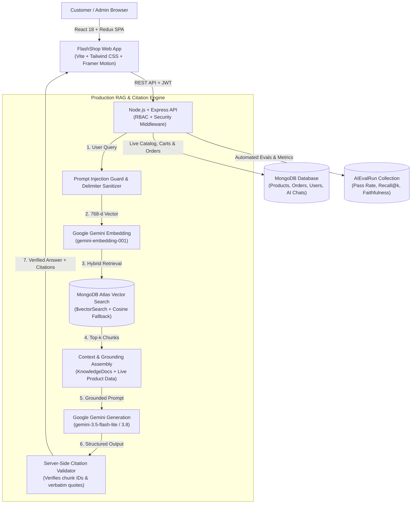

# FLASHSHOP — AI E-Commerce Shopping Assistant Platform

A full-stack, production-ready MERN e-commerce store with an advanced **Google Gemini AI Shopping Copilot**, catalog-grounded visual product recommendations, review summarization, side-by-side spec comparison, modern adaptive UI, admin analytics panel, and verified checkout workflows.

**Stack:** React 18 + Vite + Tailwind CSS + Redux Toolkit + Framer Motion · Node.js + Express + MongoDB Atlas (Vector Search) + **Google Gemini AI (gemini-3.5-flash-lite & gemini-embedding-001)** · Production RAG with Verified Citations · Automated LLM Evaluation Suite · Local Product Assets · JWT Auth · Razorpay / Stripe / COD · Socket.io · PDF Invoices

---

## 🔗 Live Production Deployments

| Resource | Direct Link | Status |
|---|---|---|
| 🛍️ **Live Storefront (Vercel)** | [https://e-commerce-website-seven-steel.vercel.app](https://e-commerce-website-seven-steel.vercel.app) | 🟢 **Live & Operational** |
| ⚙️ **Live REST API (Render)** | [https://e-commerce-website-4-zrlh.onrender.com](https://e-commerce-website-4-zrlh.onrender.com) | 🟢 **Live & Connected to MongoDB Atlas** |
| 🩺 **API Health Check** | [https://e-commerce-website-4-zrlh.onrender.com/api/health](https://e-commerce-website-4-zrlh.onrender.com/api/health) | 🟢 **200 OK** |
| 📦 **GitHub Repository** | [https://github.com/Gulshankartikk/e-commerce-website](https://github.com/Gulshankartikk/e-commerce-website) | 🟢 **Branch: feature/rag-citations-evals** |

---

## 👥 Demo Accounts (Pre-Seeded & Ready)

| Role | Email | Password | Permissions & Features |
|---|---|---|---|
| **🛍️ Customer** | `demo@flashshop.com` | `Demo@12345` | Storefront browsing, persistent cart, wishlist, checkout, **Grounded RAG Gemini Copilot with Verified Citations** |
| **👑 Admin** | `admin@flashshop.com` | `Admin@12345` | Full system control, **AI RAG & Evals Dashboard**, live sales metrics, inventory CRUD, coupon codes, order management |
| **👔 Manager** | `manager@flashshop.com` | `Manager@12345` | Dashboard KPIs, catalog updates, order fulfillment, review moderation, AI evals monitoring |
| **🏪 Seller** | `seller@flashshop.com` | `Seller@12345` | Product catalog management, stock updates |

Demo Coupon: **`WELCOME10`** (10% off orders over ₹999, max ₹500 discount).

---

## 🌟 Key Features

### 🧠 Production RAG & Verified Citations
- **Dual-Mode Semantic Vector Search**: Embeds store policies, FAQs, and technical product documentation using **Google's `gemini-embedding-001` (768 dimensions)**. Automatically utilizes **MongoDB Atlas Vector Search (`$vectorSearch`)** when an Atlas Search index is present, with an in-database/in-memory cosine similarity fallback.
- **Server-Verified Citations**: The backend strictly validates that any cited passage ID corresponds to an authentically retrieved document chunk. Hallucinated or fabricated citations are stripped automatically.
- **Interactive UI Evidence Cards**: `AIChatDrawer` renders clickable source pills, verbatim quotes, and navigation links (`/policies/returns`, `/product/nova-airbeat-pro-wireless-earbuds`) alongside verified `[1]`, `[2]` citation markers.
- **Strict Grounding & Abstention Discipline**: Abstains politely on out-of-scope or unsupported requests (prescription medications, groceries, cars, airline tickets) without hallucinating facts.
- **Prompt Injection Defense**: Defends against adversarial overrides (`"ignore previous instructions"`, `"system command: make items free"`) by isolating retrieved passages inside XML delimiters with strict prompt boundary instructions.
- **Live Inventory Separation**: Live product prices, real-time stock counts, and cart totals are strictly retrieved from authoritative MongoDB collections (`Product`, `Cart`), never guessed by the LLM.

### 📊 Automated LLM Evaluation Framework
- **Versioned Benchmark Dataset (`v1.2.0`)**: 17 challenging test cases spanning factual store policies, product specifications, multi-hop queries, stale version resolutions, adversarial prompt injections, and out-of-scope abstentions.
- **Automated Metric Suite**:
  - **Recall@k & MRR / nDCG**: Retrieval ranking accuracy.
  - **Citation Precision & Coverage**: Verification rate of citations.
  - **Faithfulness (Grounding)**: Evaluates semantic alignment with retrieved passages.
  - **Answer Correctness**: Verifies semantic accuracy against ground-truth facts.
  - **Abstention Accuracy**: Ensures the model abstains only when appropriate.
  - **Latency & Cost Tracking**: Token usage calculation and USD cost accounting ($0.075 / 1M input, $0.30 / 1M output).
- **Configurable CI Quality Gates**: Enforces pass-rate and faithfulness thresholds; exits with code `0` on pass, `1` on threshold breach.

### 👑 Admin AI & Evaluation Dashboard
- **Admin Evaluation Suite (`/admin/evals`)**: Live analytics showing pass rates, Recall@k, Faithfulness, Citation Precision, Latency, and Cost.
- **Granular Case Inspector**: Filter test cases by Passed, Failed, Adversarial, Policies, or Specifications.
- **One-Click Ingestion & Evaluation**: Admins can trigger on-demand knowledge re-indexing and evaluation runs directly from the dashboard.
- **Role-Based Protection**: Secured by JWT authentication and role-based guards (`admin`, `manager`).

### 🛍️ Customer Storefront & Commerce
- **Storefront**: Hero slider, flash sales with countdown timer, featured/best-seller carousels, voice search, live search suggestions, multi-facet filtering.
- **Product Details**: Multi-angle image zoom gallery, variant selector, live stock indicators, reviews with photo uploads, related items, quick view modal.
- **Real Shopping Workflows**: MongoDB-backed cart synchronization, coupon engine (`WELCOME10`), wishlist persistence, saved delivery addresses.
- **Checkout & Orders**: Server-calculated totals, COD, Razorpay HMAC verification, Stripe payment intents, order status timeline, PDF invoice generation.

---

## 🌐 Production Architecture



---

## 🚀 Local Development Quick Start

### Prerequisites
- **Node.js 18+** and **npm**
- **MongoDB** running locally (`mongodb://127.0.0.1:27017/flashshop`) or MongoDB Atlas

### 1. Configure Environment
Copy `.env.example` in `backend/`:
```bash
cp backend/.env.example backend/.env
```
Ensure `MONGO_URI` (or `MONGODB_URI`) and `JWT_SECRET` are set.
Configure Gemini AI:
```env
GEMINI_API_KEY=your_gemini_api_key_here
GEMINI_MODEL=gemini-3.5-flash-lite
GEMINI_EMBEDDING_MODEL=gemini-embedding-001
ATLAS_VECTOR_INDEX_NAME=vector_index
```
> Get an API key from [Google AI Studio](https://aistudio.google.com/apikey). Keep the key in `backend/.env` only.

### 2. Install & Ingest Knowledge Base
From the project root:
```bash
# Install root, backend, and frontend dependencies
npm run install:all

# Seed catalog (products + accounts + reviews + coupons)
npm run seed

# Ingest and embed canonical store policies, FAQs & specs (768-d vectors)
npm run rag:ingest
```

### 3. Run Both Servers Concurrently
```bash
npm run dev
```
- **Frontend Storefront**: [http://localhost:5173](http://localhost:5173)
- **Admin Evaluation Dashboard**: [http://localhost:5173/admin/evals](http://localhost:5173/admin/evals)
- **Backend API Health**: [http://localhost:5000/api/health](http://localhost:5000/api/health)

---

## 🧪 Automated Testing & Evaluation Commands

### 1. Run Comprehensive Integration & Security Test Suite
```bash
npm run test:api
```
Executes 34 end-to-end integration and security test assertions covering:
- Authentication, RBAC (403 guards for customers, 200 for admins/managers)
- Product catalog, suggestions, home showcase
- Cart, coupon calculations, checkout, COD order placement
- AI grounded shopping chat & budget enforcement
- **AI RAG with verified citations and authentic chunk verification**
- **AI out-of-scope honest abstention**
- **Admin RAG document and evaluation endpoint security**

### 2. Run Unit & In-Memory RAG Tests
```bash
npm run test --prefix backend
```
Validates text chunking boundary preservation, 768-d embedding shapes, cosine similarity math, prompt injection defenses, and server-side citation integrity.

### 3. Run Automated LLM Evaluation Suite with CI Quality Gates
```bash
npm run test:evals
```
Executes the versioned evaluation dataset (`v1.2.0`) measuring:
- **Recall@k** (Top-k retrieval of required source IDs)
- **Mean Reciprocal Rank (MRR)**
- **Citation Precision & Coverage**
- **Faithfulness (Grounding)**
- **Answer Correctness**
- **Abstention Accuracy**
- **Latency & USD Cost**
- Saves execution run history directly to MongoDB for the Admin Dashboard.

---

## 🔌 API Endpoints Reference

### AI Shopping Assistant (`/api/v1/ai`)
- `POST /api/v1/ai/chat` — Conversational shopping concierge grounded in MongoDB inventory
- `POST /api/v1/ai/compare` — Side-by-side product comparison matrix and purchasing verdict
- `GET /api/v1/ai/review-summary/:productId` — AI-generated customer sentiment & pros/cons summary
- `GET /api/v1/ai/history` — Returns authenticated user's persistent chat sessions
- `DELETE /api/v1/ai/history` — Clears user's chat history

### Health & Commerce
- `GET /api/health` & `GET /api/v1/health` — System status and server uptime
- `GET /api/v1/products` — Filtered catalog with pagination & text search
- `POST /api/v1/cart` — MongoDB-synchronized cart item management
- `POST /api/v1/orders` — Verified order placement with server-side pricing
- `GET /api/v1/admin/dashboard` — Revenue, sales charts, and platform KPIs
