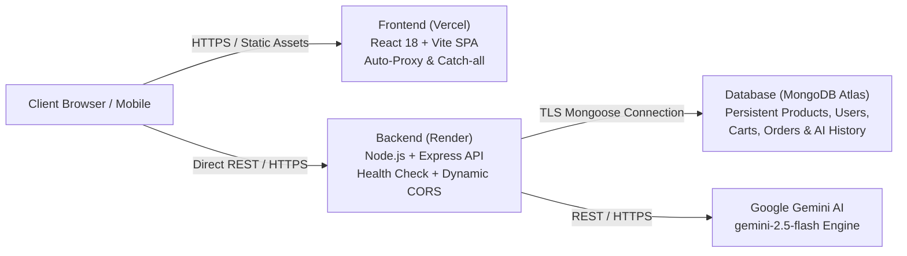

# FLASHSHOP — AI E-Commerce Shopping Assistant Platform

A full-stack, production-ready MERN e-commerce store with an advanced **Google Gemini AI Shopping Copilot**, catalog-grounded visual product recommendations, review summarization, side-by-side spec comparison, modern adaptive UI, admin analytics panel, and verified checkout workflows.

**Stack:** React 18 + Vite + Tailwind CSS + Redux Toolkit + Framer Motion · Node.js + Express + MongoDB Atlas + **Google Gemini AI (2.5 Flash)** · Local Product Assets · JWT Auth · Razorpay / Stripe / COD · Socket.io · PDF Invoices

---

## 🔗 Live Production Deployments

| Resource | Direct Link | Status |
|---|---|---|
| 🛍️ **Live Storefront (Vercel)** | [https://e-commerce-website-seven-steel.vercel.app](https://e-commerce-website-seven-steel.vercel.app) | 🟢 **Live & Operational** |
| ⚙️ **Live REST API (Render)** | [https://e-commerce-website-4-zrlh.onrender.com](https://e-commerce-website-4-zrlh.onrender.com) | 🟢 **Live & Connected to MongoDB Atlas** |
| 🩺 **API Health Check** | [https://e-commerce-website-4-zrlh.onrender.com/api/health](https://e-commerce-website-4-zrlh.onrender.com/api/health) | 🟢 **200 OK** |
| 📦 **GitHub Repository** | [https://github.com/Gulshankartikk/e-commerce-website](https://github.com/Gulshankartikk/e-commerce-website) | 🟢 **Main Branch Synced** |

---

## 👥 Demo Accounts (Pre-Seeded & Ready)

| Role | Email | Password | Permissions & Features |
|---|---|---|---|
| **🛍️ Customer** | `demo@flashshop.com` | `Demo@12345` | Storefront browsing, persistent cart, wishlist, checkout, **Grounded Gemini AI Copilot** |
| **👑 Admin** | `admin@flashshop.com` | `Admin@12345` | Full system control, live sales metrics, inventory CRUD, coupon codes, order management |
| **👔 Manager** | `manager@flashshop.com` | `Manager@12345` | Dashboard KPIs, catalog updates, order fulfillment, review moderation |
| **🏪 Seller** | `seller@flashshop.com` | `Seller@12345` | Product catalog management, stock updates |

Demo Coupon: **`WELCOME10`** (10% off orders over ₹999, max ₹500 discount).

---

## 🌟 Key Features

### 🤖 Grounded Google Gemini AI Assistant
- **Conversational Shopping Concierge**: Natural language product discovery grounded strictly in real MongoDB catalog items (no hallucinated items, prices, or specs).
- **Budget & Specification Filtering**: Enforces user constraints (e.g., *"ANC earbuds under ₹5,000"*, *"Running shoes with carbon plate"*).
- **Side-by-Side Product Comparisons**: Executive matrix evaluating prices, specs, pros/cons, and tailored purchasing verdicts.
- **AI Review Summaries**: Synthesizes verified customer reviews with sentiment scores, customer pros, and things to note.
- **Polite Handling of Unsupported Queries**: Courteously informs users when an item isn't carried and guides them to available categories.
- **Persistent Chat History**: Logged-in user sessions are saved in MongoDB (`AIChatSession`), with localStorage guest fallback.
- **Zero-Downtime Catalog Fallback**: Fully functional even if offline or before configuring a Gemini API key.

### 🛍️ Customer Storefront & Commerce
- **Storefront**: Hero slider, flash sales with countdown timer, featured/best-seller carousels, voice search, live search suggestions, multi-facet filtering (category, brand, price, color, size, rating, stock).
- **Product Details**: Multi-angle image zoom gallery, variant selector, live stock indicators, reviews with photo uploads, related items, quick view modal.
- **Real Shopping Workflows**: MongoDB-backed cart synchronization, quantity limits, coupon engine, wishlist persistence, saved delivery addresses.
- **Checkout & Orders**: Server-calculated totals (client totals are never trusted), COD, Razorpay HMAC verification, Stripe payment intents, order status timeline, PDF invoice generation.

### 👑 Multi-User RBAC & Admin Dashboard
- **Role-Based Access Control**: Pre-seeded accounts for **Admin**, **Manager**, **Seller**, and **Customer**.
- **Admin Analytics**: Live metrics (revenue, orders, active users), sales revenue charts, order processing, catalog CRUD, coupon management, and review moderation.

---

## 🌐 Production Architecture



---

## 🚀 Local Development Quick Start

### Prerequisites
- **Node.js 18+** and **npm**
- **MongoDB** running locally (`mongodb://127.0.0.1:27017/flashshop`) or MongoDB Atlas

### 1. Configure Environment
Copy `.env.example` in `backend/`:
```bash
cp backend/.env.example backend/.env
```
Ensure `MONGO_URI` (or `MONGODB_URI`) and `JWT_SECRET` are set.
Add your Gemini API key (optional for basic fallback, required for live Gemini responses):
```env
GEMINI_API_KEY=your_gemini_api_key_here
GEMINI_MODEL=gemini-2.5-flash
```
> Get an API key from [Google AI Studio](https://aistudio.google.com/apikey). Keep the key in `backend/.env` only. Never expose it in client code.

### 2. Install & Seed Catalog
From the project root:
```bash
# Install root, backend, and frontend dependencies
npm run install:all

# Seed catalog (8 sample products + verified reviews + demo users + coupons)
npm run seed
```

### 3. Run Both Servers Concurrently
```bash
npm run dev
```
- **Frontend Storefront**: [http://localhost:5173](http://localhost:5173)
- **Backend API Health**: [http://localhost:5000/api/health](http://localhost:5000/api/health)

---

## 🧪 Automated Test Suite

Run the full end-to-end integration and security test suite:
```bash
npm run test:api
```
Tests 29 critical workflows including:
1. API Root Health Check (`/api/health` and `/api/v1/health`)
2. Multi-user authentication & role guards (`admin`, `manager`, `seller`, `user`)
3. RBAC security boundaries (403 forbidden checks)
4. Storefront catalog listing, text search, suggestions & category filters
5. Cart operations, coupon calculation (`WELCOME10`), address creation & COD checkout
6. Order status lifecycle & admin user role management
7. **AI Natural Language Shopping Chat** with grounded recommendations
8. **AI Budget Enforcement** (verifies all recommended items are $\le$ budget)
9. **AI Unsupported Product Handling**
10. **AI Review Summary with Evidence from Real Reviews**
11. **AI Side-by-Side Comparison Matrix & Verdict**
12. **AI Persistent Chat History**

---

## 🔌 API Endpoints Reference

### AI Shopping Assistant (`/api/v1/ai`)
- `POST /api/v1/ai/chat` — Conversational shopping concierge grounded in MongoDB inventory
- `POST /api/v1/ai/compare` — Side-by-side product comparison matrix and purchasing verdict
- `GET /api/v1/ai/review-summary/:productId` — AI-generated customer sentiment & pros/cons summary
- `GET /api/v1/ai/history` — Returns authenticated user's persistent chat sessions
- `DELETE /api/v1/ai/history` — Clears user's chat history

### Health & Commerce
- `GET /api/health` & `GET /api/v1/health` — System status and server uptime
- `GET /api/v1/products` — Filtered catalog with pagination & text search
- `POST /api/v1/cart` — MongoDB-synchronized cart item management
- `POST /api/v1/orders` — Verified order placement with server-side pricing
- `GET /api/v1/admin/dashboard` — Revenue, sales charts, and platform KPIs
